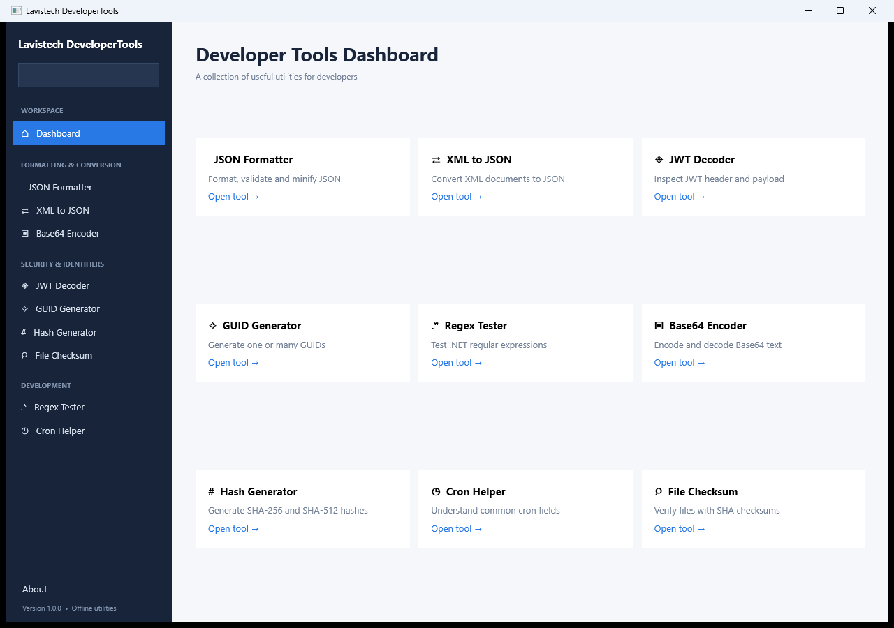

# LAVISTECH DEVELOPER TOOLS

### Everyday developer utilities, on your PC.

A free and open-source Windows desktop app for formatting, converting, decoding, and checking the text and files you already work with. Input stays on the machine. Nothing is uploaded.



[Features](#features) |
[Requirements](#requirements) |
[Download](#download) |
[Build from Source](#build-from-source) |
[License](LICENSE)

Put together by [Lavistech Solutions](https://lavistech.com/). Current version: **1.0.0**. Windows PC, 64-bit. The project and executable name is `LavistechDeveloperTools`. The name shown in the window is Lavistech DeveloperTools.

Source code: [lavistechsolutions/LavistechDeveloperTools](https://github.com/lavistechsolutions/LavistechDeveloperTools)

## Features

Open a tool from the dashboard or the sidebar. The sidebar search filters the tool list. Each tool writes to an output box you can copy or clear.

- **JSON Formatter.** Validate JSON, pretty-print it, or minify it. Invalid JSON is reported in the status line.
- **XML to JSON.** Convert an XML document to indented JSON. Repeated child elements become arrays. Attributes are written under `@attributes`, and mixed text content under `#text`.
- **Base64 Encoder.** Encode UTF-8 text to Base64, or decode Base64 back to UTF-8 text.
- **JWT Decoder.** Show the header and payload of a JSON Web Token as formatted JSON. The signature, issuer, audience, and expiry are left unchecked. Use it to inspect a token, not to trust one.
- **GUID Generator.** Create 1 to 500 GUIDs in one run. Formats are D (`xxxxxxxx-xxxx-xxxx-xxxx-xxxxxxxxxxxx`), N (32 digits), B (`{...}`), and P (`(...)`).
- **Hash Generator.** SHA-256 or SHA-512 of UTF-8 text, printed as lowercase hex.
- **File Checksum.** SHA-256 or SHA-512 of a file you pick. The file is read as a stream. Paste an expected checksum to compare; the match is case-insensitive.
- **Regex Tester.** Run a .NET regular expression against sample text. Options are none, ignore case, multiline, or singleline. Each match is listed with its index and length.
- **Cron Helper.** Break a five-field expression into minute, hour, day of month, month, and day of week, and list the meaning of `*`, `,`, `-`, and `/`. It explains the fields. It does not calculate the next run, and cron dialects differ.

## Requirements

Windows 10 or Windows 11, 64-bit.

| What you want to do | What to install |
| --- | --- |
| Build or run from source on this PC | [.NET 10 SDK](https://dotnet.microsoft.com/download/dotnet/10.0) |
| Run a framework-dependent build on another PC | [.NET 10 Desktop Runtime](https://dotnet.microsoft.com/download/dotnet/10.0) |
| Run a self-contained publish | Nothing else. The runtime is included. |

The SDK includes the runtime used to run a local build, so a separate Desktop Runtime install is not required on the machine you build on.

## Download

A self-contained 64-bit build is produced with the publish command in [Build from Source](#build-from-source). Run `LavistechDeveloperTools.exe` from `bin\Release\net10.0-windows\win-x64\publish\`. That program includes the .NET runtime, so the PC does not need a separate .NET install.

When a release is published, the file name to attach is `LavistechDeveloperTools-win-x64.zip`. It should contain the program plus `LICENSE`, `EULA.txt`, `THIRD-PARTY-NOTICES.txt`, and this README.

## Build from Source

Install the [.NET 10 SDK](https://dotnet.microsoft.com/download/dotnet/10.0). Open `LavistechDeveloperTools.sln` in Visual Studio 2026, or any Visual Studio version with the .NET 10 SDK, and build.

Or from this directory:

```powershell
dotnet build -c Release
```

The executable is written to:

```text
bin\Release\net10.0-windows\LavistechDeveloperTools.exe
```

`dotnet build` produces a framework-dependent program. Another PC needs the .NET 10 Desktop Runtime to run that output.

A self-contained build carries the runtime with it, so the target PC does not need .NET installed:

```powershell
dotnet publish .\LavistechDeveloperTools.csproj -c Release -r win-x64 --self-contained true -p:PublishSingleFile=true
```

Published files are placed under:

```text
bin\Release\net10.0-windows\win-x64\publish\
```

## License

The Lavistech Developer Tools project code is covered by the [MIT License](LICENSE). The [EULA](EULA.txt) covers official builds and does not narrow the MIT License. This release does not bundle a third-party library. Platform notes are in [THIRD-PARTY-NOTICES.txt](THIRD-PARTY-NOTICES.txt).

To report a vulnerability, see [SECURITY.md](SECURITY.md). To contribute, see [CONTRIBUTING.md](CONTRIBUTING.md). Release history is in [CHANGELOG.md](CHANGELOG.md).

## Feedback

[lavistech.com/contact](https://lavistech.com/contact)
